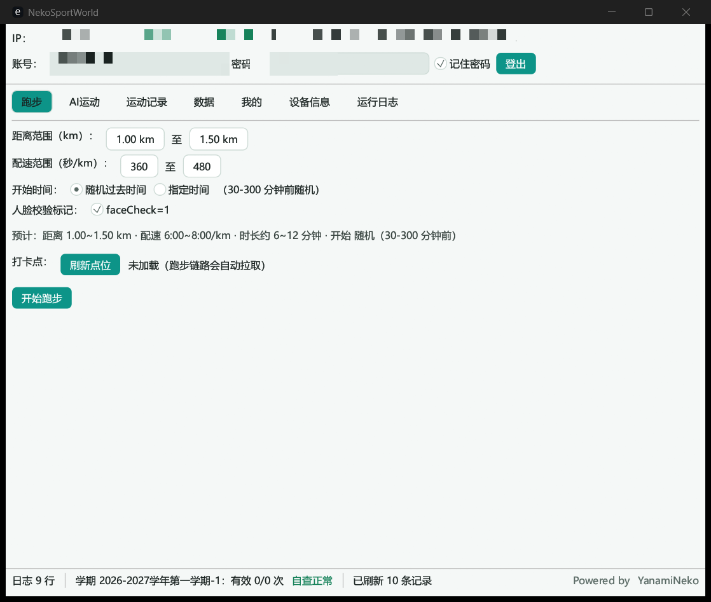

# Sports simulation


> ## ⚠️ 重要声明（请先读完再继续）
>
> 本项目是一个**技术研究项目**，用于学习以下课题：
> Rust 编写的加密信封协议实现、移动端风控字段的构造方式、GPS 轨迹的数学建模、
> 客户端与服务器之间的数据交互结构。
>
> **本仓库不提供任何预编译的可执行文件，也不鼓励、不支持任何实际使用。**
>
> 如果你打算用它来替代真实的体育课出勤，请立刻关闭页面。下面这些功能能做到的事
> 属于**违反学校规定**的行为，后果包括但不限于学业成绩作废、纪律处分、学籍处理。
>
> 详见文末 [免责声明](#免责声明)。

---

运动世界校园版客户端协议的研究性实现，纯 Rust 编写，桌面端 GUI / CLI 双模式，并包含 Android 客户端的构建脚本。

## 仓库内容

**本仓库只包含源码。** 不提供预编译的 `exe` 或 `apk`，你需要自行从源码构建（见[构建](#构建)）。

> 早期版本曾发布过预编译产物，已全部下架。已下载的用户请自行删除。

## 功能

- **跑步**：一键全链（策略 → 打卡点 → 轨迹 → 提交 → OBS → 验证）。轨迹按打卡点自然生成，开始时间支持随机或指定到前 3 天；路线颜色可选全绿色或灰绿混合
- **操场模式**：支持自动拟合、200 / 300 / 400 米标准跑道、固定跑道（绕圈）与自定义圈长；绕圈模式横向漂移覆盖整条 8 道跑道
- **真实道路模式**：基于 OSM 路网与高德路线，沿校园道路生成轨迹
- **AI 运动**：任务 / 自由练习双模式，支持批量补签（前 60 天 × 多项目）
- **数据**：学期完成度、违规自查、排行榜（个人 / 班级 / 院系 × 日 / 月，室内榜、历史榜）、个人主页
- **登录**：支持人机验证自动通过
- **自动更新**：桌面端检查 / 下载 / 自替换并重启（GitHub Release 直连）；Android 下载 APK 后调起系统安装器

## 界面



## 使用

### GUI

自行构建后运行 `sportssimulation.exe`，在界面中登录并配置参数。账号、设备身份和配置保存在程序同目录的 JSON 文件中。

### CLI

```text
Sports simulation login --user <手机号> --pass <密码> --remember
Sports simulation run                                  # 一键跑步（--altitude 17.2 固定海拔，或 11.6-22.8 映射到区间）
Sports simulation run --dry-run --dist 2 --pace 360 --lat 39.9 --lon 116.4
                                                         # 本地生成并校验轨迹/五点/OBS，不登录、不联网、不上传
Sports simulation run --track-color full-green         # 全绿色（默认）；也可选 half-green-gray
Sports simulation run --track loop:400                 # 固定跑道 400 米绕圈
Sports simulation ai --sport 2 --score 26000           # AI 运动
Sports simulation rank main --type 1 --sort 1          # 排行榜
Sports simulation update [--check]                     # 自动更新（--check 仅检查不下载）
Sports simulation template --file run.gpx              # 本地分析真实记录海拔（不会上传）
Sports simulation help                                 # 全部命令
```

`template` 只读取本地 GPX / JSON 文件，输出采样点、海拔范围、累计上升和下降，不会登录或上传数据。

`run --dry-run` 使用本地轨迹生成器构造完整样本，校验坐标一致性、五点包装、OBS 字段和速度窗口；它不会创建登录客户端，也不会发起网络请求。`--lat` / `--lon` 可显式指定本地校验锚点，省略时使用已保存的设备锚点。

手动海拔支持三种状态：留空使用自动海拔；填写单个数字（如 `17.2`）让所有轨迹点使用固定海拔；填写区间（如 `11.6-22.8`）将海拔曲线映射到该上下限内，同时保留相对起伏。

青龙定时任务：首次手动执行 `login --remember`，之后定时执行 `run` 即可。

### Android

- 面向 Android 16（target SDK 36）的 ARM64 手机，最低 API 26。
- 包名为 `org.sportssimulation.tool`；从旧版（`org.nekosportsworld.tool`）升级需先卸载旧版。
- 点击账号、密码或数值字段会弹出系统输入法；数据保存在应用私有目录，卸载会清除。
- 自更新：关于页可检查新版本（需 `Releases` 中存在 APK 资产，当前仓库不提供）。
- 首次安装需在系统设置中允许本应用“安装未知应用”。

## 构建

### Windows / 桌面端

```bash
cargo build --release                        # GUI + CLI
cargo build --release --no-default-features  # 仅 CLI
```

产物位于 `target/release/sportssimulation.exe`。

### Android

需要 PowerShell 7、Rust、JDK 21 以及 Android SDK 组件（`platforms;android-36`、`build-tools;36.0.0`、`ndk;29.0.14206865`、`platform-tools`）：

```powershell
rustup target add aarch64-linux-android
./android/build.ps1 -Abi arm64-v8a -Profile release
```

产物位于 `android/build/arm64-v8a-release/Sports-simulation-arm64-v8a.apk`。详见 [android/README.md](android/README.md)。

### 测试

```bash
cargo test --all
```

推 tag（`v*`）会触发 GitHub Actions 自动构建并发布 Release（见 `.github/workflows/`）。

## 常见问题

- **提示未登录 / 401**：先执行 `login --remember`（GUI 勾选记住密码等价），会话失效会自动重登
- **10121 设备风险**：设备身份会持久化，删除 `identity.json` 等于换新设备，不要频繁删除
- **10603 点位限流**：点位接口 5 分钟限 3 次，程序内置 300s 缓存，正常使用不会触发
- **榜单为空**：当天还没有人产生有效里程，查询会自动回退最近 3 天
- **检查更新失败**：更新仅直连 GitHub，网络不通时请自行从源码重新构建
- **手动更新**：重新构建后替换旧文件；请保留 `config.json`、`identity.json`、`points_cache.json` 等配置文件（内含账号与设备身份，不要提交到仓库）
- **人机验证失败**：自动重试 3 轮，仍失败大概率是网络波动，稍后再试
- **杀软误报**：未签名编译产物可能被误报，请自行判断后加白

## 免责声明

**1. 本项目的性质**

本仓库是个人在逆向工程与协议分析方向上的学习笔记，代码与文档仅供**研究和教学**用途。
作者不提供任何形式的安装包、成品工具或使用指导。

**2. 关于实际使用**

本项目所实现的全部功能，其唯一现实用途是替代或伪造校园体育考勤数据。作者**明确反对**
将本项目用于任何形式的实际使用。使用本项目意味着：

- 违反学校对学生出勤与体育考核的规定
- 可能触发服务端风控，导致记录被判违规、成绩作废
- 可能面临学校的纪律处分乃至学籍处理
- 相关行为可能违反《学生手册》及平台用户协议

**上述后果由使用者自行承担。**

**3. 关于责任限制**

作者不对本项目代码的完整性、可靠性、安全性作任何保证。因使用、修改或分发本项目
（或其衍生作品）产生的任何直接或间接损失，作者不承担责任。

需要说明的是：**这份声明不能免除作者在故意协助他人违规时可能承担的责任**。
因此本仓库刻意不提供可直接运行的成品，只保留可供研究的源代码。

**4. 关于数据与隐私**

本项目不收集、不上传任何用户数据。所有账号凭据、设备标识、轨迹记录均保存在使用者
本机。构建源码时请勿将真实的配置或运行数据提交到公开仓库。

**5. 关于第三方权益**

本项目基于 [YanamiNeko/NekoSportsWorldTool](https://github.com/YanamiNeko/NekoSportsWorldTool)
修改而来，遵循其 CC BY-NC 4.0 协议（禁止商用），感谢原作者的开源工作。

本项目与运动世界校园版官方无任何关联，未获其授权。文中提及的产品名称、商标归各自所有者。

## 许可证

[CC BY-NC 4.0](LICENSE) © YanamiNeko（禁止商用）
